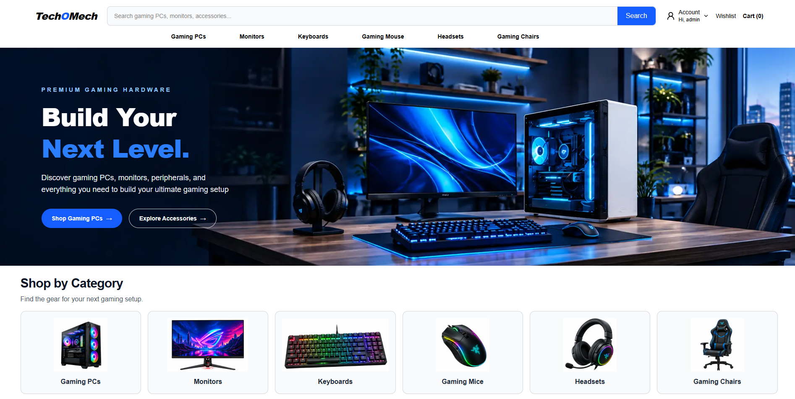
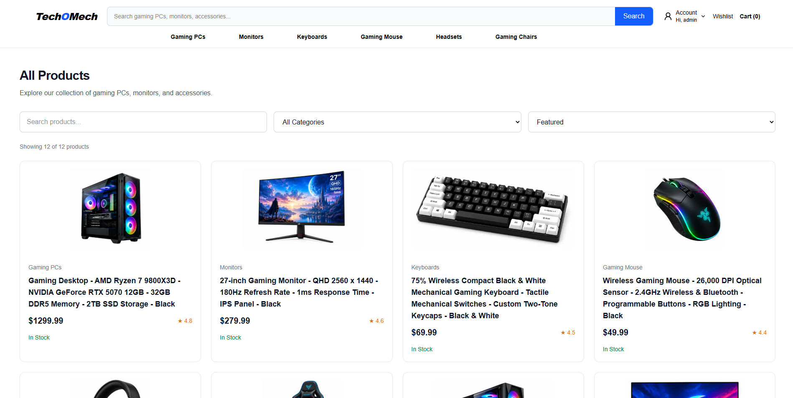
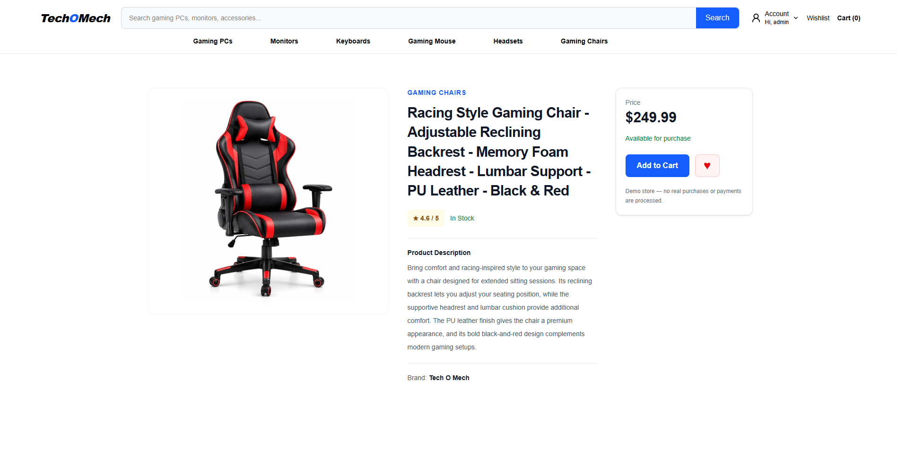
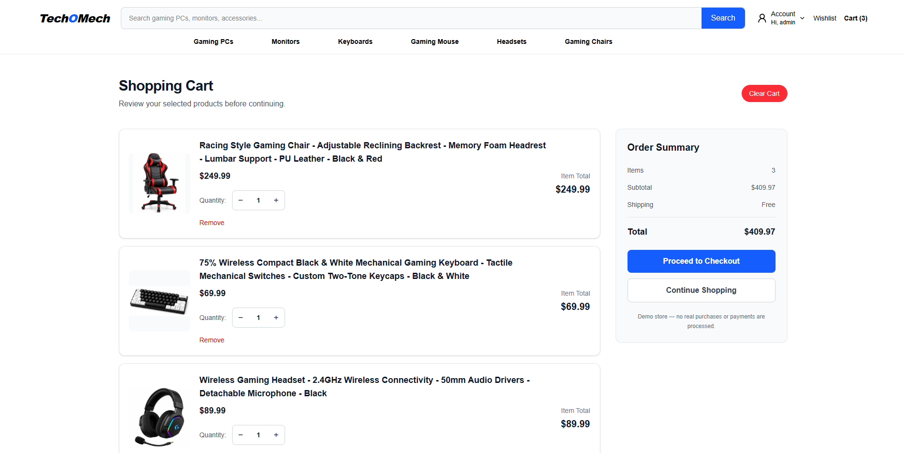
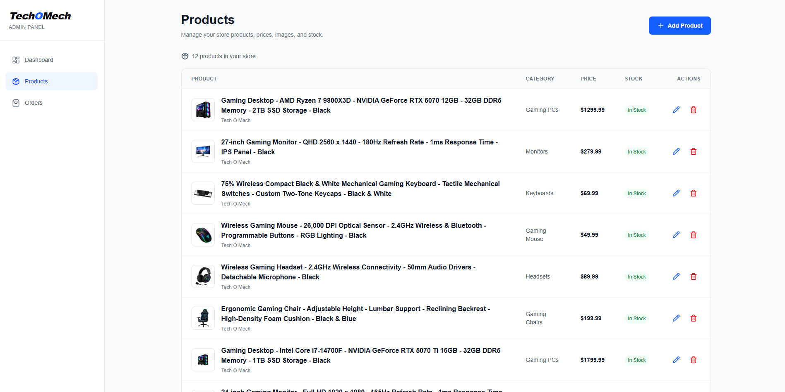

# Tech O Mech

A modern e-commerce demo platform for gaming PCs, computer hardware, and accessories.

**Live Demo:** [https://tech-o-mech.vercel.app](https://tech-o-mech.vercel.app)

## Overview

Tech O Mech is a full-stack e-commerce portfolio project built to demonstrate modern web development skills. It provides a shopping experience where users can browse products, manage their cart and wishlist, and place demo orders.

The project also includes an administrative dashboard for managing products and customer orders.

## Features

### Customer Features
- Browse gaming PCs, monitors, keyboards, mice, headsets, and other hardware.
- Search and explore products.
- View individual product details.
- Add and remove products from the shopping cart.
- Manage a wishlist.
- User registration and authentication.
- Demo checkout and order placement.
- View order history and order statuses.

### Admin Features
- Admin authentication.
- Dashboard for managing the store.
- Add, edit, and delete products.
- Manage product details and images.
- Manage customer orders.
- Update order statuses.

## Tech Stack

- **Framework:** Next.js (App Router)
- **Language:** TypeScript
- **Styling:** Tailwind CSS
- **Backend & Database:** Supabase
- **Authentication:** Supabase Auth
- **Testing:** Vitest
- **Deployment:** Vercel
- **Version Control:** Git & GitHub

## Screenshots

### Homepage


### Products Page


### Product Details


### Shopping Cart


### Admin Dashboard


## Getting Started

### Prerequisites

- Node.js
- npm
- A Supabase project

### Installation

1. Clone the repository:

   ```bash
   git clone https://github.com/arishgillani/tech-o-mech.git
   ```

2. Navigate to the project directory:

   ```bash
   cd tech-o-mech
   ```

3. Install dependencies:

   ```bash
   npm install
   ```

4. Create a `.env.local` file in the root directory and configure your Supabase credentials:

   ```env
   NEXT_PUBLIC_SUPABASE_URL=your_supabase_url
   NEXT_PUBLIC_SUPABASE_PUBLISHABLE_KEY=your_supabase_publishable_key
   ```

5. Start the development server:

   ```bash
   npm run dev
   ```

6. Open [http://localhost:3000](http://localhost:3000) in your browser.

## Testing

Unit tests are written using Vitest.

Run the test suite:

```bash
npm run test
```

## Deployment

The application is deployed on Vercel:

[https://tech-o-mech.vercel.app](https://tech-o-mech.vercel.app)

## Important Note

Tech O Mech is a portfolio demonstration project. Checkout and order management are provided for demonstration purposes. The application does not process real payments or collect real payment card information.